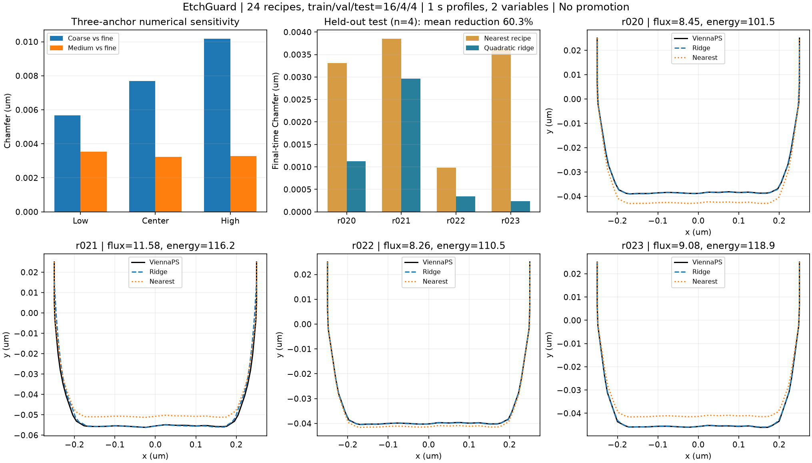

# EtchGuard 현황 보고 — 2026-10-28

**현재는 실제 ViennaPS 생성 데이터로 작은 학습 모델을 만들고, 학습에 쓰지 않은 recipe에서 같은 평가기로 비교한 단계다.** 팀 모델 통합이나 실제 공정 품질 승인을 완료한 것은 아니다.

## 앞선 결과와 이번 결과

| 단계 | 확인한 것 |
| --- | --- |
| 합성 PoC | 파일 검사, 평가·판정, 차단 후 champion 보존과 CI |
| 외부 VTP | 팀 고정 fixture 1 recipe/4 snapshots의 재료별 연결성 복원 |
| 직접 생성 smoke | 실제 ViennaPS CPU 실행→VTP 검사→prediction bundle 평가, 오류 주입 차단 |
| 이번 수치 점검 | 대표 조건 3개×수치 설정 3개, medium/fine 차이 확인 |
| 이번 학습·평가 | 24 recipe를 16/4/4로 분리, train-only 정규화, val로 alpha 선택, test 4개 평가 |

## 이번 실험에서 얻은 결과

물리 설정은 한 번에 1초를 계산하도록 바꿨다. 변동 변수는 ion_flux 8~12와 ion_mean_energy 80~120이며 다른 5개 조건은 고정했다. 총 33회 생성은 수치 비교 9회와 데이터 생성 24회로 구성된다. 원본은 66개 VTP snapshot이다.

### 수치 설정

medium=.025um/300rays, fine=.0125um/600rays 비교에서 Chamfer .003235~.003544um, 깊이 차이 최대 .000496um였다. 세 anchor 모두 사전 탐색 조건 안에 들어 medium으로 학습 데이터를 생성했다. grid/rays를 동시에 바꾸었으며 전체 범위의 수렴성을 증명한 것은 아니다.

### 독립 test 결과 — 1초 최종 단면만 평가

| 지표 (um) | 최근접 recipe baseline | 2차 다항 ridge |
| --- | --- | --- |
| 평균 Chamfer | .00294403 | .00116810 |
| 최대 recipe Chamfer | .00385503 | .00296409 |
| 깊이 MAE | .00364269 | .00004825 |
| 탐색 정책 PASS | 4/4 | 4/4 |

평균 Chamfer는 이 표본에서 약 60.3% 감소했다. 선택한 alpha=.0001은 validation 4개에서 결정했고 test로 다시 조정하지 않았다. model JSON을 다시 읽어 예측했으며, 별도 사후 재생에서도 지표가 정확히 같았다. 승격은 하지 않았다.

test 중 2개는 한 변수에서 train 표본의 min/max 밖이다. 계획한 국소 범위 안의 제한적 외삽을 포함한 결과이며, 모든 경우를 순수 보간이라고 소개하지 않는다.

## 실행 과정에서 확인한 한계

1. **원 실행의 마지막 정리 단계가 완결되지 않았다.** 학습·판정 파일은 생성됐지만 상위 명령이 비정상 종료했고 통합 manifest가 없었다. 원본 33건·요청·모델·학습 지문을 확인한 뒤 별도 봉인 및 예측 재생을 완료했다. 원 실행 정상 종료와 사후 검증을 구분한다.
2. **실행 환경의 주변 비용이 크다.** dataset case 전체 wall time 중앙값 약 24.9초, import 뒤 시뮬레이션·저장 구간의 중앙값 약 1.55초였다. import·프로세스 시작·파일 I/O 등의 비용이 포함된 차이이며, 원인을 아직 분리 측정하지 않았다. 이를 팀 클러스터의 원인으로 일반화하지 않는다.
3. **수치 오차가 모델 오차보다 클 수 있다.** model Chamfer .00117um보다 medium/fine 차이 .0032~.0035um가 크다. 실제 장비에서 그 정밀도를 달성한다는 뜻이 아니다.
4. **실험 범위가 좁다.** test 4개, 2변수, 단일 설계 seed, 고정 1초다. FNO/MGN·7변수 전 범위·장시간 rollout·독립 OOD는 검증하지 않았다.
5. **형상·coverage 검증은 제한적이다.** 단일 열린 평면 경계를 지원하며 마지막 로그 delta를 남겼다. 모든 시각의 coverage 수렴이나 물리적 보정은 인증하지 않았다.

## 검증 상태

- Linux 선택 의존성 환경 전체 82개 테스트 통과.
- recipe/run ID 분리, 학습 전용 scaler, 고정 최종 시각과 시점 선택 검사.
- 손상된 저장 모델의 차원·정규화 검사를 추가.
- 33개 원본의 지문 재검사, 모델을 다시 학습하지 않는 예측 재생, 외부 manifest 기록 완료.
- raw와 학습 모델은 generated 폴더에 유지. Git에는 코드·작은 지표·지문·그림만 반영한다.

## 다음 우선순위

**데이터 규모나 모델 크기를 바로 늘리기보다, 이 평가 경로에 팀 예측 결과 한 묶음을 연결하는 것이 우선이다.** EtchGuard의 목적은 새로운 FNO를 경쟁적으로 만드는 것보다 서로 다른 결과를 같은 계약으로 비교·검증하는 데 있다.

그와 병행해 수치 비교에서 grid와 rays를 따로 바꾸고, 평가에 쓰지 않은 새 validation 조건으로 coverage·시간 처리·표현 오차를 확인한다. 현재 test 결과를 보며 기준이나 alpha를 조정하면 다음 실험으로 분리하고, 이번 test를 독립 시험으로 재사용하지 않는다.

참조: [실험 설계](LOCAL_STUDY.md), [앞선 실제 생성](VIENNAPS_SMOKE.md), [예측 파일 계약](PREDICTION_BUNDLE.md), [수치·재생 증거](../reports/evidence/local-study-20261028.json).
